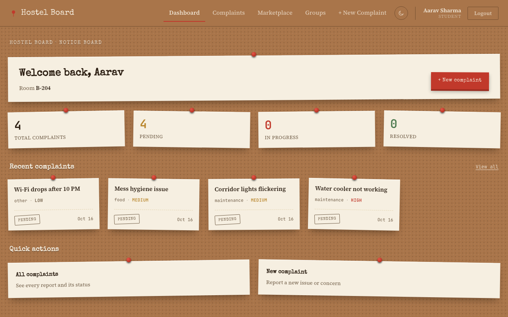
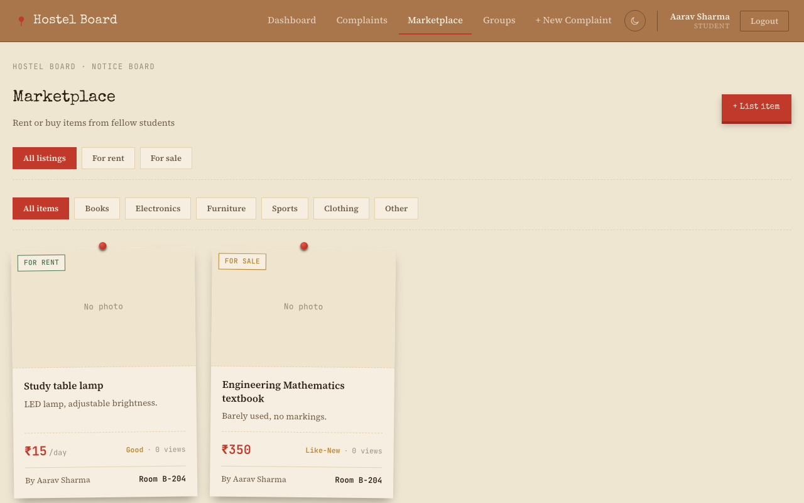

# Hostel Board

A full-stack hostel management app. Students raise and track complaints, buy, sell or rent items in a campus marketplace, and join interest groups. Admins and wardens review complaints and update their status. The UI is styled as a pinned-paper notice board, with light and dark themes.




## Features

- **Roles**: `student`, `admin`, `warden` (`backend/models/User.js`). Students self-register; admin and warden accounts come from `backend/seed.js`.
- **Complaints**: file a complaint by category and priority, follow its status (pending, in-progress, resolved, rejected), and comment on it. Other students see only a name, never room or contact details (`backend/controllers/`).
- **Marketplace**: list items for rent or for sale, filter by type and category, upload compressed photos. Owner phone numbers are stripped from API responses.
- **Groups**: public or private interest groups with member chat.
- **Admin dashboard**: complaint queue with status, priority and notes.
- **Security**: JWT auth, bcrypt password hashing, zod request validation, CORS allowlist, rate-limited auth routes (`backend/middleware/`).

## Tech stack

| Layer | Tools |
| --- | --- |
| Frontend | React 19, React Router 7, Axios, Vite 8 |
| Backend | Node.js, Express 4, Mongoose 7 |
| Database | MongoDB |
| Auth and validation | jsonwebtoken, bcryptjs, zod, express-rate-limit, cors |

## Project layout

```
backend/    Express API: routes/, controllers/, models/, middleware/, seed.js, server.js
frontend/   React app (Vite): src/pages, src/components, src/api, src/context
docs/       README screenshots
```

## Setup

Prerequisites: Node.js 18+, and MongoDB running locally or a MongoDB Atlas URI.

1. Install dependencies for the root, backend and frontend:

   ```bash
   npm install
   npm run install-all
   ```

2. Configure the backend. Copy `backend/.env.example` to `backend/.env` and set `JWT_SECRET` (at least 32 characters; the server refuses to start without it):

   ```bash
   cp backend/.env.example backend/.env
   node -e "console.log(require('crypto').randomBytes(48).toString('base64url'))"
   ```

   Other variables: `MONGODB_URI`, `PORT` (default 5001), `CLIENT_ORIGINS` (default `http://localhost:3000`), `JWT_EXPIRES_IN`.

3. Configure the frontend. Copy `frontend/.env.example` to `frontend/.env`. `VITE_API_URL` defaults to `http://localhost:5001`.

   ```bash
   cp frontend/.env.example frontend/.env
   ```

4. Create the admin and warden accounts:

   ```bash
   npm run seed
   ```

   Default credentials are printed by the script and defined in `backend/seed.js`. Change them before any real deployment.

5. Start both servers:

   ```bash
   npm run dev
   ```

   API on `http://localhost:5001`, frontend on `http://localhost:3000` (`frontend/vite.config.js`).

## Scripts

| Command | What it does |
| --- | --- |
| `npm run dev` | Backend and frontend together |
| `npm run backend` / `npm run frontend` | One side only |
| `npm run seed` | Create admin and warden accounts |
| `npm run build --prefix frontend` | Production build into `frontend/build/` |

## API overview

Routes live in `backend/routes/`: `auth.js` (register, login), `complaints.js`, `rentals.js` (marketplace), `groups.js`. Everything except register and login requires a `Bearer` token.

Last checked against the code: 2026-10-16.
